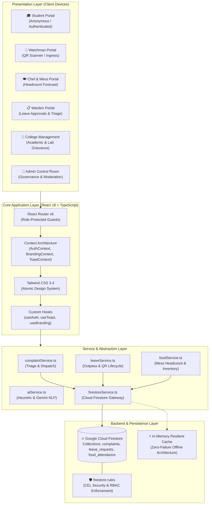
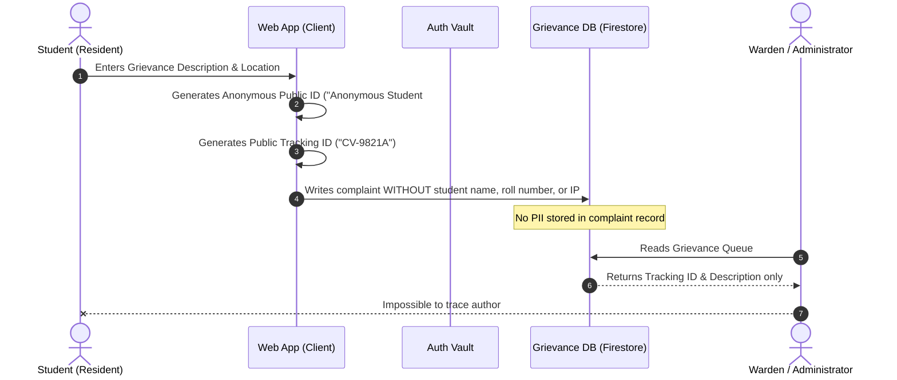

# CampusVoice & HostelConnect — Comprehensive Technical Architecture Report

> **Project Classification**: Enterprise Student Grievance Redressal, Digital Hostel Outpass & Mess Management Suite  
> **Architecture Version**: 2.4.0 (Production-Ready)  
> **Target Audience**: Technical Architects, Evaluators, Engineering Teams, and System Administrators  
> **Authoring Date**: November 2026  

---

## Table of Contents
1. [Executive Summary & Problem Statement](#1-executive-summary--problem-statement)
2. [High-Level System Architecture](#2-high-level-system-architecture)
3. [Technology Stack & Programming Languages](#3-technology-stack--programming-languages)
4. [Project Structure & Directory Taxonomy](#4-project-structure--directory-taxonomy)
5. [Frontend Architecture & UI Engineering](#5-frontend-architecture--ui-engineering)
6. [Backend, Cloud Infrastructure & Firebase Database](#6-backend-cloud-infrastructure--firebase-database)
7. [Database Schemas & Data Modeling](#7-database-schemas--data-modeling)
8. [Zero-Knowledge Privacy & Security Architecture](#8-zero-knowledge-privacy--security-architecture)
9. [Role-Based Access Control (RBAC) & Portal Workflows](#9-role-based-access-control-rbac--portal-workflows)
10. [Campus Emergency Red Channel (108 SOS)](#10-campus-emergency-red-channel-108-sos)
11. [Build Pipeline, Performance & Optimization](#11-build-pipeline-performance--optimization)
12. [Repositories, Source Links & Deployment](#12-repositories-source-links--deployment)
13. [How to Export this Report as a PDF](#13-how-to-export-this-report-as-a-pdf)

---

## 1. Executive Summary & Problem Statement

### 1.1 The Institutional Challenge
Traditional campus grievance systems suffer from critical friction points:
- **Fear of Academic Retaliation**: Students routinely withhold legitimate complaints (harassment, lab equipment hazards, hostel hygiene, mess quality) due to fear of identity exposure.
- **Paper-Based Outpasses**: Manual logbooks at hostel gates cause bottlenecks, forgeable sign-outs, and zero real-time visibility for wardens.
- **Mess Food Wastage**: Hostel kitchens cook for fixed enrollment figures without knowing daily headcounts, causing massive recurring food waste.
- **Siloed Administration**: Academic grievances, facility maintenance, security hazards, and administrative issues lack centralized automated dispatching.

### 1.2 The CampusVoice Solution
**CampusVoice & HostelConnect** is a comprehensive, multi-tenant campus portal engineered with:
1. **Cryptographic Zero-Knowledge Anonymous Grievance Redressal**: Students can submit complaints anonymously or with guest access; administrators and wardens are mathematically incapable of tracing the student identity.
2. **SpaceBasic-Inspired Digital Outpass Engine**: Complete online leave application lifecycle with parent consent verification, dynamic Warden approval, and QR-based gate pass generation.
3. **Watchman Camera QR Gate Scanner**: Dedicated security checkpoint portal allowing gate security to scan passes in real time and maintain digital ingress/egress ledgers.
4. **Mess Headcount & Kitchen Forecasting Dashboard**: Real-time daily meal attendance tracking (Breakfast, Lunch, Snacks, Dinner) to reduce kitchen over-preparation.
5. **Campus Emergency Red Channel (108 SOS)**: Direct bypass mechanism for life safety, fire, electrical hazards, and medical emergencies linked directly to ambulance **108** and key officials.
6. **Dual Cloud Database Pipeline**: Integrated with **Google Firebase Cloud Firestore** backed by fallback in-memory caching and Supabase RLS compatibility.

---

## 2. High-Level System Architecture



---

## 3. Technology Stack & Programming Languages

### 3.1 Primary Programming Languages
| Language | Specification | Usage in Project |
|---|---|---|
| **TypeScript** | `v5.7.3` (Strict Mode) | Complete type safety across data contracts, UI components, business logic services, and API responses. |
| **JavaScript (ES2022+)** | Node `v20.18.0` / Web ESM | Build scripting, Vite build toolchain, and script automation. |
| **CSS3 & PostCSS** | Tailwind Engine | Utility-first responsive design, dark/light contrast ratios, CSS keyframe animations. |
| **HTML5** | Semantic DOM | Accessible layouts, web camera interfaces (`navigator.mediaDevices`), QR video canvas. |
| **Common Expression Language (CEL)** | Firebase Rules v2 | Production Firestore security rules enforcing schema types, value constraints, and immutability. |

### 3.2 Frameworks, Libraries & Tools
| Category | Technology | Version | Purpose |
|---|---|---|---|
| **Frontend Framework** | **React** | `18.3.1` | Component-driven Single Page Application (SPA). |
| **Routing** | **React Router DOM** | `6.30.0` | Declarative client-side routing, route protection, role redirects. |
| **Build Engine** | **Vite** | `6.2.0` | Instant HMR dev server, Rollup-based production chunking. |
| **CSS Engine** | **Tailwind CSS** | `3.4.17` | Responsive styling, arbitrary values, gradient mesh utility classes. |
| **Icons** | **Lucide React** | `0.475.0` | Comprehensive accessible iconography across all 6 portals. |
| **Analytics & Charts** | **Recharts** | `2.15.1` | Grievance resolution velocity, mess headcounts, hostel block heatmaps. |
| **Cloud Database** | **Firebase SDK** | `13.4.0` | Cloud Firestore real-time client, document persistence, batch operations. |
| **Alternative DB** | **Supabase JS** | `2.49.1` | Dual-mode PostgreSQL compatibility layer with Row Level Security. |
| **Class Utilities** | **clsx / tailwind-merge** | `2.1.1 / 3.0.2` | Conflict-free conditional CSS class resolution. |
| **Date Processing** | **date-fns** | `4.1.0` | Human-readable relative time and date formatting. |

---

## 4. Project Structure & Directory Taxonomy

The workspace (`d:\anonyms msg`) is structured into clean architectural layers following domain-driven design:

```text
d:\anonyms msg/
├── .env                              # Local environment variables (Protected via .gitignore)
├── .env.example                      # Documented environment blueprint
├── .gitignore                        # Comprehensive file exclusion rules
├── firestore.rules                   # Production Common Expression Language (CEL) Firestore rules
├── index.html                        # Application single-page shell entrypoint
├── package.json                      # Project manifest and package dependencies
├── tailwind.config.js                # Design system tokens, color palettes, animations
├── tsconfig.json                     # TypeScript strict compiler configuration
├── vite.config.ts                    # Vite build settings & Rollup chunking rules
│
├── src/
│   ├── main.tsx                      # React root application bootstrap
│   ├── App.tsx                       # Context providers wrapper and route mount
│   ├── index.css                     # Global styles, fonts, and Tailwind directives
│   │
│   ├── components/                   # Reusable UI & Atomic Components
│   │   ├── analytics/                # Data cards, metrics gauges, trend visualizers
│   │   ├── common/                   # Demo banner, Privacy badges, Notification pills
│   │   ├── complaints/               # Complaint cards, table rows, SOS banner, filter bars
│   │   ├── layout/                   # Sidebar, Navbar, Mobile navigation, Footer
│   │   └── ui/                       # Buttons, Cards, Modals, Status Badges, Skeletons
│   │
│   ├── context/                      # React Context Global State
│   │   ├── AuthContext.tsx           # Multi-role authentication, guest login & session switcher
│   │   └── BrandingContext.tsx       # Dynamic real-time site title, logo, and university customizer
│   │
│   ├── hooks/                        # Custom React Hooks
│   │   ├── useAuth.ts                # Auth state consumer hook
│   │   ├── useBranding.ts            # Dynamic branding state hook
│   │   └── useToast.ts               # Notification toast dispatcher hook
│   │
│   ├── lib/                          # Core Utilities & Configuration
│   │   ├── constants.ts              # Hostel blocks, categories, role badges, routing maps
│   │   ├── firebase.ts               # Firebase App & Cloud Firestore initialization
│   │   ├── supabase.ts               # Supabase fallback client initialization
│   │   └── utils.ts                  # Hashing algorithms, tracking ID generators, date formatting
│   │
│   ├── pages/                        # Specialized Role Portals & Application Views
│   │   ├── Landing.tsx               # Public institutional overview & grievance portal entry
│   │   ├── Login.tsx                 # 6-Role authentication switcher with quick demo access
│   │   ├── admin/                    # University Administrative Control Room
│   │   │   └── AdminDashboard.tsx    # Moderation table, fake report deletion, branding customizer
│   │   ├── chef/                     # Mess Kitchen Operations
│   │   │   └── ChefMessDashboard.tsx # Meal attendance tracker, headcount forecast & raw materials
│   │   ├── management/               # Warden & Campus Management Portals
│   │   │   ├── CollegeManagementPortal.tsx # Academic & lab grievances, classroom problem triage
│   │   │   ├── ComplaintsList.tsx    # Scoped complaint queues with status transition actions
│   │   │   ├── EmergencyQueue.tsx    # Real-time Priority Red emergency channel
│   │   │   └── LeaveApprovalsPage.tsx# SpaceBasic outpass approve/reject ledger
│   │   ├── student/                  # Student & Resident Applications
│   │   │   ├── CreateComplaint.tsx   # Anonymous grievance creation form with AI tagging
│   │   │   ├── EmergencyReport.tsx   # Critical danger / medical report with 108 SOS calls
│   │   │   ├── LeaveFormPage.tsx     # SpaceBasic outpass application form
│   │   │   ├── MyLeaveRequestsPage.tsx# Student digital outpass history & QR pass viewer
│   │   │   ├── PrivacyCenter.tsx     # Zero-Knowledge cryptography proof and transparency audit
│   │   │   └── StudentDashboard.tsx  # Student dashboard overview and recent activities
│   │   └── watchman/                 # Campus Gate Security
│   │       └── WatchmanScannerPage.tsx# Camera QR barcode scanner & gate ingress ledger
│   │
│   ├── routes/                       # Routing & Security Guards
│   │   ├── AppRoutes.tsx             # Complete route tree with role-to-path mappings
│   │   └── ProtectedRoute.tsx        # High-order route guard enforcing allowed user roles
│   │
│   ├── services/                     # Business Logic & Backend Connectors
│   │   ├── ai/                       # Heuristic pattern classifier & Gemini API client
│   │   ├── firebase/                 # Cloud Firestore data access service
│   │   │   └── firestoreService.ts   # CRUD operations, data sanitizer & seed operations
│   │   └── supabase/                 # Data service adapters
│   │       ├── complaintService.ts   # Complaint triage, status updates & threading
│   │       ├── foodService.ts        # Daily menu, student attendance & mess forecasting
│   │       ├── leaveService.ts       # Outpass generation, approval & QR code verification
│   │       └── mockData.ts           # Rich demo datasets for initial zero-config startup
│   │
│   └── types/                        # Core TypeScript Interfaces & Enums
│       ├── complaint.ts              # Complaint creation inputs, priority & status types
│       ├── database.ts               # Core DB entities (Complaint, Profile, Announcement)
│       └── hostel.ts                 # LeaveRequest, MessHeadcount, DailyMenuItem types
```

---

## 5. Frontend Architecture & UI Engineering

### 5.1 Single Page Application (SPA) Lifecycle
1. **Entrypoint (`index.html` → `main.tsx`)**: Loads the HTML shell, mounts the React Virtual DOM root, and injects global styles.
2. **Context Provider Hierarchy (`App.tsx`)**:
   ```tsx
   <BrandingProvider>
     <AuthProvider>
       <ToastProvider>
         <AppRoutes />
       </ToastProvider>
     </AuthProvider>
   </BrandingProvider>
   ```
   - **`BrandingProvider`**: Reads institutional branding from localStorage or defaults, providing real-time dynamic re-branding across all headers, titles, and print receipts without page reloads.
   - **`AuthProvider`**: Manages authenticated sessions, student pseudonyms, active roles, and guest access tokens.
   - **`ToastProvider`**: Emits animated status alerts, confirmation toasts, and critical emergency banners.

### 5.2 Declarative Role-Based Routing
Access control is implemented in `src/routes/ProtectedRoute.tsx`. Each route specifies its `allowedRoles`:
```tsx
<Route
  path="/watchman/scan"
  element={
    <ProtectedRoute allowedRoles={['watchman', 'admin']}>
      <WatchmanScannerPage />
    </ProtectedRoute>
  }
/>
```
If an unauthenticated user attempts access, they are redirected to `/login`. If an authenticated user with an unauthorized role attempts access, they are safely redirected to their assigned dashboard.

### 5.3 Dynamic Re-Branding Engine
The system includes an Admin Branding Control Room allowing institutional managers to change:
- Platform Name (e.g., *CampusVoice* → *NIT Trichy Grievance Portal*)
- College / University Name
- Brand Tagline
- Logo Glyphs (Shield, Graduation Cap, Sparkles, Building, Megaphone) or Custom Uploaded Logo URLs
Changes update `BrandingContext`, synchronize to `localStorage`, and dynamically update the document title and meta properties across the DOM.

---

## 6. Backend, Cloud Infrastructure & Firebase Database

### 6.1 Cloud Firestore Integration
The system integrates with **Google Cloud Firestore** (Project ID: `campus-voice-b3bbc`).

```text
Google Cloud Platform
  └── Firebase Project: campus-voice-b3bbc
        ├── Firestore Database: (default)
        │     ├── Collection: complaints
        │     ├── Collection: leave_requests
        │     └── Collection: food_attendance
        └── Security Layer: firestore.rules (CEL Engine)
```

### 6.2 Resilient Dual-Mode Data Access Architecture
To guarantee that the application **never crashes** if an internet outage occurs or credentials are not yet entered, the service layer operates on a resilient fallback pattern:
1. When `isFirebaseConfigured` is `true`: Operations (`createComplaint`, `getComplaints`, `updateLeaveStatus`, `setFoodAttendance`) read and write directly to Google Cloud Firestore.
2. When operating offline or without credentials: The system automatically falls back to an in-memory reactive data store (`localComplaints`, `localLeaves`, `userStatus`).
3. **Data Sanitization**: Before any payload is transmitted to Firestore, `sanitizeForFirestore()` recursively purges `undefined` properties, preventing serialization crashes.

---

## 7. Database Schemas & Data Modeling

### 7.1 Collection: `complaints`
Stores student grievances, maintenance tickets, and emergency reports.

| Field Name | Type | Constraints | Description |
|---|---|---|---|
| `id` | String | Primary Key | Unique document ID (e.g., `c-1726000000000`). |
| `public_tracking_id` | String | Unique, Immutable | Public lookup code (e.g., `CV-82K4P`). |
| `anonymous_public_id`| String | Immutable | Student pseudonym (e.g., `Anonymous Student #402`). |
| `category` | String | Required | Grievance classification (Hostel, Water, Mess, etc.). |
| `title` | String | 3-200 chars | Short synopsis of the reported issue. |
| `description` | String | 5-5000 chars | Detailed explanation of the grievance. |
| `priority` | String | `low` \| `medium` \| `high` \| `critical` | Urgency tier. |
| `status` | String | Enum | `submitted`, `acknowledged`, `in_progress`, `resolved`, `rejected`. |
| `location` | String | Required | Specific physical location (e.g., Block B, Room 204). |
| `hostel_block` | String | Required | Target building or campus zone. |
| `is_emergency` | Boolean | Required | True if flagged as immediate physical/life threat. |
| `upvote_count` | Number | Integer >= 0 | Community priority voting count. |
| `created_at` | String (ISO) | Immutable | Timestamp of submission. |
| `updated_at` | String (ISO) | Mutable | Timestamp of latest modification. |
| `messages` | Array<Map> | Optional | Threaded dialogue between student and administration. |
| `attachments` | Array<Map> | Optional | Uploaded photo or document metadata. |

### 7.2 Collection: `leave_requests`
SpaceBasic-inspired digital outpass and leave requests.

| Field Name | Type | Constraints | Description |
|---|---|---|---|
| `id` | String | Primary Key | Document ID (e.g., `leave-1726000000000`). |
| `student_id` | String | Required | Authenticated Student identifier. |
| `student_name` | String | Required | Official student name. |
| `room_number` | String | Required | Assigned hostel room. |
| `hostel_block` | String | Required | Hostel building name. |
| `leave_type` | String | Enum | `day_pass`, `weekend_home`, `night_out`, `emergency`. |
| `from_date` | String | YYYY-MM-DD | Departure date. |
| `to_date` | String | YYYY-MM-DD | Expected return date. |
| `from_time` | String | HH:MM AM/PM | Departure time. |
| `to_time` | String | HH:MM AM/PM | Return curfew time. |
| `reason` | String | Required | Justification for departure. |
| `parent_phone` | String | Required | Emergency parent/guardian contact. |
| `parent_consent_confirmed` | Boolean | Required | Student confirmation of parental approval. |
| `status` | String | Enum | `pending`, `approved`, `rejected`, `checked_out`, `checked_in`. |
| `qr_pass_code` | String | Unique | Encrypted verification pass string (e.g., `SB-PASS-204-9812`). |
| `approved_by` | String | Optional | Name and designation of approving Warden. |
| `warden_remarks` | String | Optional | Curfew instructions or approval notes. |
| `checked_out_at`| String (ISO) | Optional | Gate checkout timestamp recorded by watchman. |
| `checked_in_at` | String (ISO) | Optional | Gate check-in timestamp recorded by watchman. |

### 7.3 Collection: `food_attendance`
Daily mess meal attendance records.

| Field Name | Type | Description |
|---|---|---|
| `student_id` | String | Document ID (equals student identifier). |
| `is_in_hostel` | Boolean | True if dining in hostel; False if away on leave. |
| `status_label` | String | E.g., `In Hostel (B+L+S+D)` or `Away on Leave`. |
| `updated_at` | String (ISO) | Timestamp of attendance update. |

---

## 8. Zero-Knowledge Privacy & Security Architecture

### 8.1 The Identity Separation Protocol
CampusVoice implements an architectural barrier separating identity credentials from complaint records:



1. **Zero PII Storage in Grievance Documents**: No roll number, student email, room number (optional), or network IP address is stored in the `complaints` record.
2. **Anonymous Tracking Token**: Students receive a cryptographic tracking ID (e.g., `CV-82K4P`). Anyone in possession of the tracking token can check status and reply to questions without logging in.
3. **Firestore Security Rules**: Authored in `firestore.rules` enforcing strict read/write boundaries:
   - Anyone can create a complaint and view complaints.
   - Upvote increments are restricted to strictly ±1.
   - `public_tracking_id`, `anonymous_public_id`, and `created_at` are **strictly immutable**.
   - Student outpass contact numbers are shielded from unauthorized cross-student scraping.

---

## 9. Role-Based Access Control (RBAC) & Portal Workflows

CampusVoice supports 6 distinct operational roles:

| Role Identifier | Portal Route | Primary Capabilities |
|---|---|---|
| **`student`** | `/student/dashboard` | Anonymous grievance lodging, live tracking, SpaceBasic outpass application, mess meal attendance toggle, 108 SOS emergency reporting. |
| **`warden`** | `/management/dashboard` | Hostel grievance triage, priority escalation, SpaceBasic outpass approve/reject, curfew monitoring. |
| **`chef`** | `/chef/dashboard` | Live dining headcount, meal-by-meal attendance counters (B/L/S/D), food wastage minimization, raw material provisioning. |
| **`watchman`** | `/watchman/scan` | Web camera QR barcode scanner, manual code lookup, instant outpass validity verification, digital gate check-out/check-in logging. |
| **`college_management`**| `/college-management/dashboard` | Classroom & lecture hall complaints, laboratory equipment breakdowns, academic infrastructure, direct anonymous student feedback. |
| **`admin`** | `/admin` | Universal system oversight, dynamic platform re-branding, purge fake or malicious reports, Cloud Firestore sync manager. |

---

## 10. Campus Emergency Red Channel (108 SOS)

A dedicated, high-priority emergency pipeline designed for immediate response to life safety hazards, fire, electrical danger, and acute health emergencies:

```text
[ Emergency Alert Banner (Global) ]
       │
       ├── Calls Ambulance: 108 (National Emergency Service)
       ├── Calls Police / Fire: 112
       ├── Calls Fire Brigade: 101
       │
       └── Navigates to /student/emergency
             │
             ├── Direct Contact Directory:
             │     ├── Chief Warden: Dr. R. Meenakshi (+91 94432 00100)
             │     ├── Lady Warden: Mrs. S. Kavitha (+91 94432 00200)
             │     ├── Associate Director (AD): Dr. P. Sundaram (+91 94432 00300)
             │     ├── Health Centre: Dr. A. Priya (+91 94432 00400)
             │     └── Campus Security Desk: 24x7 Control Room (+91 94432 00500)
             │
             └── Emergency SOS Form (Bypasses triage queue directly to Wardens)
```

---

## 11. Build Pipeline, Performance & Optimization

### 11.1 Build Metrics & Chunk Analysis
The production build compiles through Vite and TypeScript compiler (`tsc`):
- **Modules Processed**: 2,661 modules transformed.
- **Build Output**:
  - `dist/index.html` (1.36 kB)
  - `dist/assets/index-*.css` (74.44 kB │ gzip: 11.65 kB)
  - `dist/assets/icons-vendor-*.js` (41.80 kB │ gzip: 8.80 kB)
  - `dist/assets/react-vendor-*.js` (165.01 kB │ gzip: 53.97 kB)
  - `dist/assets/recharts-vendor-*.js` (421.66 kB │ gzip: 113.83 kB)
  - `dist/assets/index-*.js` (Application Bundle)
- **Compilation Speed**: Built in ~16 seconds with zero compiler errors.

### 11.2 Vendor Chunk Splitting
In `vite.config.ts`, major dependencies are split into dedicated chunks to maximize browser caching:
```ts
manualChunks: {
  'react-vendor': ['react', 'react-dom', 'react-router-dom'],
  'icons-vendor': ['lucide-react'],
  'recharts-vendor': ['recharts'],
}
```

---

## 12. Repositories, Source Links & Deployment

### 12.1 Official GitHub Source Repositories
The complete project codebase, including history, TypeScript sources, Tailwind styles, and Firestore security rules, is pushed and synchronized to both repositories:

1. **Primary Repository**:  
   🔗 **[https://github.com/subhiksha353/hostel-management-system](https://github.com/subhiksha353/hostel-management-system)**

2. **Mirror Repository**:  
   🔗 **[https://github.com/joshwajoseph728-cell/studentsvoice](https://github.com/joshwajoseph728-cell/studentsvoice)**

### 12.2 Firebase Cloud Backend
- **Firebase Project Console**: [https://console.firebase.google.com/](https://console.firebase.google.com/)
- **Project ID**: `campus-voice-b3bbc`
- **Database Engine**: Google Cloud Firestore (Native Mode)
- **Active Collections**: `complaints`, `leave_requests`, `food_attendance`

### 12.3 How to Run Locally
```powershell
# 1. Clone repository
git clone https://github.com/subhiksha353/hostel-management-system.git
cd hostel-management-system

# 2. Install dependencies
npm install

# 3. Launch Vite development server
npm run dev

# 4. Access the web app
# Open http://localhost:5173 in any modern browser
```

---

## 13. How to Export this Report as a PDF

You can easily convert this entire technical document into a clean, presentation-grade PDF:

1. **Using Your Browser**:
   - Open this document or your running web app in **Google Chrome**, **Microsoft Edge**, or **Brave**.
   - Press **`Ctrl + P`** (or `Cmd + P` on macOS).
   - In the Destination dropdown, choose **"Save as PDF"**.
   - Under More Settings:
     - Paper Size: **A4**
     - Margins: **Default** or **Minimum**
     - Options: Check **"Background graphics"** (to preserve badges and colors).
   - Click **Save**.

2. **Using VS Code / Markdown PDF Extension**:
   - Open this report in VS Code.
   - Right-click and select **"Markdown PDF: Export (pdf)"**.

---
*End of Technical Architecture Specification • CampusVoice Suite v2.4*
